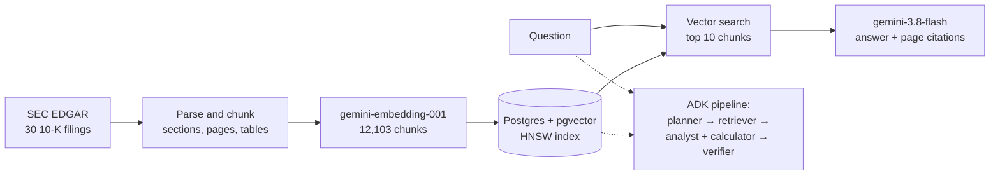

# Financial Analyst RAG

Ask a question about a US company's annual report (10-K) and get the answer with the filing and page it came from. Every design choice is measured on FinanceBench, for accuracy, cost and time.

Python · Gemini · Google Agent Development Kit (ADK) · Postgres + pgvector · SEC EDGAR · FinanceBench

## Results

Scored on the **57 FinanceBench questions** that fall inside the 30 filings indexed here (10 companies × 3 years), out of the 150 in FinanceBench's public sample. No filter is given: search runs over all 30 filings. In practice it never left the right company (every top-20 chunk was from it), probably because the question and each chunk's header both name it.

| Approach | Correct | 95% CI | Cost / question | Median time |
|---|---|---|---|---|
| **One Gemini call over vector search** (the default) | **54 / 57 (95%)** | 86–98% | **$0.0077** | **7.5 s** |
| Multi-agent pipeline on ADK (planner, retriever, analyst, verifier) | 52 / 57 (91%) | 81–96% | $0.064 | 32.7 s |

| Retrieval only (no LLM) | Evidence page in the top 5 | 95% CI |
|---|---|---|
| **Vector search** | **49 / 57 (86%)** | 75–93% |
| Hybrid: keyword (BM25) + vector, fused with RRF | 30 / 57 (53%) | 40–65% |

What the numbers say:

- **Use one call, not the agents.** The agents are no more accurate (1 question gained, 3 lost, exact McNemar p = 0.625), cost 8.3× as much and take 4× as long (about 8 model calls per question against 1; the single call was timed 4 at a time, the agents one at a time). Their verifier changed 1 answer in 57 and cost almost half the total.
- **Hybrid search was measured and rejected.** Keyword search misses the financial tables that hold most answers ("capital expenditure" in the question, "Purchases of property, plant and equipment" in the filing), and fusion pushes vector search's good hits down. Hit@5 fell from 86% to 53% (p < 0.001).
- **The agents' planner is accurate, but as a filter it is unlikely to help the single call here.** The cheapest Gemini model named the right company for 57 of 57 questions and included the right year for 55, at $0.0002 each. Replayed as a filter in front of the single call (from the saved plans, no API calls), it lifts hit@5 from 49 to 51 of 57, but the evidence is in the top 10, which the answer reads, for the same 54 questions either way. Even the right filing given by hand left answers at 54 / 57. No answer run with the planner's filter has been done.
- **The grading was checked, within limits.** A second grader from another model family agreed on 162 of 171 grades (Cohen's kappa 0.37). With no filter alone: 53 of 57, kappa 0.30. Kappa is low because almost every answer is correct, which makes agreement by chance high. The second grader was a one-off Claude session, the same family as the assistant this was built with. The strictest count, correct by both graders, is 52 / 57 for the single call. The agents were graded by Gemini only.
- **Against the [FinanceBench paper](https://arxiv.org/abs/2311.11944) (2023), indicative only.** On all 150 questions, GPT-4-Turbo got 19% right with one store over all 360 filings, 50% with the right filing's store, and 85% given the evidence pages. Here: 95%, 95% and 98% on 57 of them. The no-filter row is far easier than the paper's (30 filings, not 360), so the closer comparisons are the other two. Even those differ in the model (much newer here), the grading (people in the paper, a Gemini grader here), the retrieval and prompts, and the questions (10-K only, from roughly the 10 companies with the most of them); how much each explains isn't measured.
- **Caveats.** 57 questions is a small test, as the intervals show, and the system is near its ceiling on it (56 / 57 when given the evidence pages). FinanceBench has been public since 2023, so the models may have seen some of it; a run with no sources would test that, and hasn't been done.

The hybrid, answer and agent methods were written down before their runs and not tuned on the 57 questions; the vector baseline and its gold labels were built on the same 57, and there is no separate development set. Every number comes from a real run, saved in [`results/`](results); the full write-up, with error analysis, is in [docs/EVALUATION.md](docs/EVALUATION.md).

## How it works



- **Ingest:** downloads each 10-K from EDGAR, splits it into its 10-K items and pages, and chunks it (about 500 tokens of text, or one table with its caption). Every chunk keeps company, fiscal year, section, page and the SEC URL, so answers can cite them.
- **Index:** Gemini embeddings in Postgres with pgvector; BM25 keyword search in plain SQL for the hybrid comparison.
- **Answer:** the top 10 chunks go to Gemini with their citations; the reply is JSON with the answer and the sources it used. Replies are cached and every call's tokens and cost are recorded; evaluation runs take a spending cap (`--max-usd`).
- **Agents** (ADK `SequentialAgent`): a cheap planner picks the company, years and searches; code retrieves the chunks; an analyst answers using a safe `calculate` tool for arithmetic; a verifier re-checks figures and calculations.

More detail: [docs/BUILD.md](docs/BUILD.md).

## Try it

Needs Python 3.11+, Docker and a Gemini API key. Embedding the whole corpus on a paid key costs about $0.55 and takes 4–5 minutes (estimated from $0.53 and 250 s measured for about 11,400 of the 12,103 chunks). A free-tier key embeds only about 1,000 chunks a day ([docs/BUILD.md](docs/BUILD.md)): the full index takes about 13 daily runs of `scripts/embed_daily.sh`; a same-day start is below.

```bash
git clone https://github.com/CostisStavrou/financial-analyst-rag.git && cd financial-analyst-rag
python3 -m venv .venv && .venv/bin/pip install -e ".[dev]"
cp .env.example .env    # fill in SEC_USER_AGENT (name + email) and GEMINI_API_KEY
docker compose up -d    # Postgres 17 + pgvector on localhost:5433
```

Then build the index and ask questions:

```bash
.venv/bin/python -m finrag download   # 30 10-Ks from SEC EDGAR (~140 MB)
.venv/bin/python -m finrag parse      # sections, pages, chunks
.venv/bin/python -m finrag db-init    # schema and indexes
.venv/bin/python -m finrag index      # embed and load the chunks
.venv/bin/python -m finrag ask "Amcor trade receivables at the end of fiscal 2020" --ticker AMCR --year 2020
.venv/bin/python -m finrag answer "How many people did PepsiCo employ at the end of 2022?"
.venv/bin/python -m finrag agent "By what percentage did PepsiCo's net revenue grow from fiscal 2021 to fiscal 2022?"
```

On a free-tier key, embed Best Buy alone in place of the `index` line: it is the only company under a day's quota (917 chunks). The Amcor and PepsiCo examples need the full index.

```bash
EMBED_RPM=90 EMBED_TPM=28000 .venv/bin/python -m finrag index --tickers BBY
.venv/bin/python -m finrag answer "What was Best Buy's revenue in fiscal 2023?" --ticker BBY
```

`ask` shows the retrieved chunks, `answer` gives one Gemini answer with sources, and `agent` runs the multi-agent pipeline and prints each step's tokens, cost and time. Output from an earlier run (27 Oct) with FinanceBench's wording of the Amcor question; FinanceBench's evidence is page 50:

```
   5 hits | embed 701 ms | search 16 ms
[1] score 0.782 | Amcor 10-K FY2020, Item 8. Financial Statements and Supplementary Data, p. 50 (printed page 50) | table
    ... | Trade receivables, net | 1,615.9 | 1,864.3 | ...
    https://www.sec.gov/Archives/edgar/data/1748790/000174879020000025/amcr-20200630.htm
```

**Web demo:** `.venv/bin/python -m finrag serve` opens a page at http://127.0.0.1:8000. You ask a question and get the answer with the passages it relies on, each with its filing, page and a link to SEC.gov, plus what the question cost and how long it took. Fresh Gemini calls are capped at $1 a day by default (`--usd-per-day`), and saved replies are free. It is built for running locally; what it needs before going public is listed in [docs/BUILD.md](docs/BUILD.md#web-demo).

The evaluations: `eval-retrieval` (add `--method hybrid` for hybrid search), `eval-answers` (`--estimate` prices a run first), `eval-agents --max-usd 5 --tag <name>`, and `eval-replay`, which replays the saved agent run's plans through today's retrieval with no API calls (it needs that run's local files and embedding cache, so it can't run from a fresh clone). They download FinanceBench on first use (`.venv/bin/python -m finrag financebench` fetches it and shows the coverage). Tests: `.venv/bin/python -m pytest` (no API key needed).

## Status

Built and measured: ingestion, vector and hybrid search, single-call answers, the ADK pipeline, and the evaluation. Built, for running locally: a web demo of the single call.

- **Agent retrieval fix, checked offline but not re-graded.** The agents' two refusals came from how sources were capped at 20: the question's own top 10 came first for every planned year, so with two years none of the planner's searches got in, and with three the third year was cut too (in both refusals, the year asked about). The merge now takes each list's hits rank by rank, so every year and search gets in (tested in [`tests/test_agents.py`](tests/test_agents.py)). Replaying the saved plans with no API calls ([`results/replay_retrieval.json`](results/replay_retrieval.json)), an evidence page now reaches the sources for 54 of 57 questions instead of 50, both refusals included (5 gained, 1 lost; p = 0.22). The 91% above is from the old version; answers with the fix haven't been generated or graded.
- **Not built yet:** a public deployment of the demo on Cloud Run, a cross-check of figures against the SEC's structured XBRL data, reranking, and a harder test set beyond these 57 questions.

## How this was built

Built from 27 Oct to 2 Nov 2026 with Claude Code (Anthropic) as the coding assistant, which is why commits carry its co-author line. The hybrid, answer and agent methods were written down before their runs, every paid run had an agreed spending cap, and every number above comes from a real run saved in [`results/`](results).

## Repo layout

```
config/companies.toml   corpus: companies, CIKs, fiscal years
finrag/ingest/          EDGAR download, HTML parsing, chunking
finrag/index/           embeddings (Gemini or local), Postgres schema and loading
finrag/retrieve/        vector search with filters, BM25 keyword search, hybrid (RRF)
finrag/answer/          Gemini answers with citations, reply cache, token and cost accounting
finrag/agents/          ADK pipeline: planner, retriever, analyst with calculator, verifier
finrag/eval/            FinanceBench loading, page check, retrieval, answer and agent scoring, offline replay
finrag/web/             the web demo: FastAPI app and one HTML page
finrag/cli.py           python -m finrag <command>
results/                evaluation results: per-question ranks, labels, tokens, cost; no FinanceBench text
docs/                   build details and the full evaluation write-up
tests/                  unit tests, no API calls; BM25 tests also run against the local database when it is up
```

## Data and licence

- **SEC EDGAR:** 10-K filings, fetched through SEC's free API with an identifying `User-Agent` and at most 2 requests a second. Filings are downloaded into `data/` and not committed.
- **FinanceBench:** [`PatronusAI/financebench`](https://huggingface.co/datasets/PatronusAI/financebench) (Islam et al., 2023, [arXiv:2311.11944](https://arxiv.org/abs/2311.11944)), licensed **CC BY-NC 4.0**. It is downloaded on demand and not redistributed: result files and tests hold question ids, never question or answer text, and the docs refer to questions by id, quoting at most a short phrase.
- **Code:** [MIT](LICENSE).
